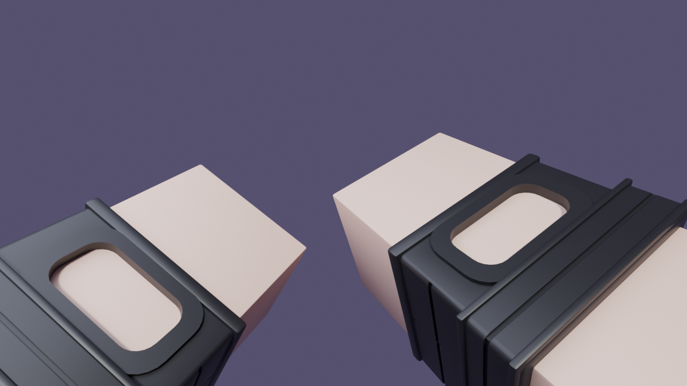
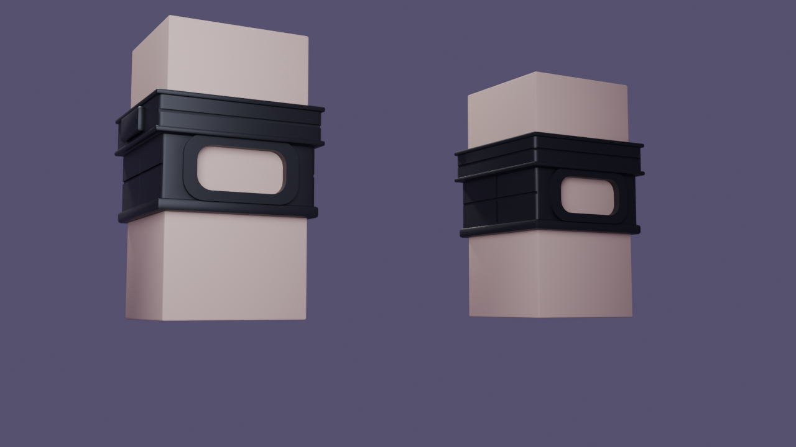
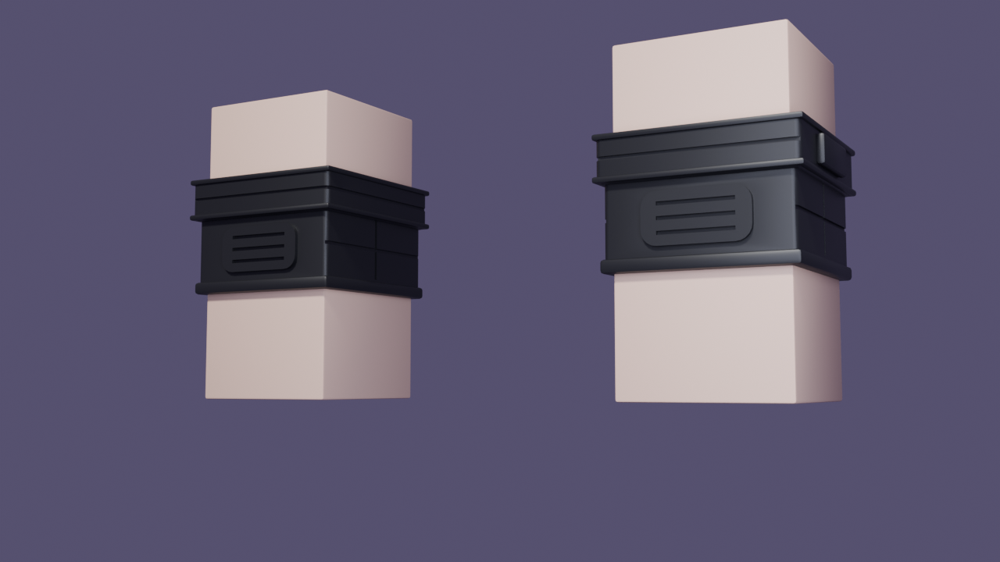

# Brazos FPS para Roblox

Brazos en primera persona estilo Roblox: un bloque de piel con un guante táctico negro sin dedos. El guante tiene una ventana en el dorso, un reborde en los nudillos, un puño con anillos, una pestaña de velcro y una almohadilla de agarre en la palma.



| Dorso | Palma |
| --- | --- |
|  |  |

## Archivos

| Archivo | Para qué sirve |
| --- | --- |
| `brazos_fps.fbx` | El archivo que se importa en Roblox Studio |
| `brazos_fps.blend` | El modelo editable en Blender |
| `generar_brazos.py` | El script que genera todo. Cambia las medidas y vuelve a ejecutarlo |
| `previews/` | Renders de referencia |

## Medidas

- 1 unidad de Blender = 1 stud.
- Cada brazo (`BrazoDerecho`, `BrazoIzquierdo`) mide **1 × 2 × 1 studs**, igual que un brazo R6. La mano apunta hacia abajo.
- Cada guante (`GuanteDerecho`, `GuanteIzquierdo`) es una pieza aparte, para que la piel y el guante tengan colores distintos en Roblox.
- La ventana del guante queda en la cara **Front** de la pieza. La pestaña de velcro va en el lado de fuera (**Right** en el brazo derecho, **Left** en el izquierdo).
- Triángulos: unos 108 por brazo y unos 1.300 por guante.

## Importar en Roblox Studio

1. Abre **Import 3D** (pestaña Home o Avatar) y elige `brazos_fps.fbx`.
2. En la ventana del importador, si existe la opción **Scale Unit** (en *File Dimensions*), pon **Stud**. Después pulsa **Import**.
3. Comprueba que `BrazoDerecho` tenga `Size = 1, 2, 1`. Si llegó con otro tamaño, escala el modelo entero con la herramienta Scale (o `Model:ScaleTo()`) hasta que lo tenga. Así las piezas mantienen sus proporciones.
4. Pon los colores (el importador no los trae de forma fiable):
   - `BrazoDerecho` / `BrazoIzquierdo`: `Color = 245, 205, 182`, `Material = SmoothPlastic`. También puedes usar el color de piel del jugador, por ejemplo `BodyColors.RightArmColor3`.
   - `GuanteDerecho` / `GuanteIzquierdo`: `Color = 27, 27, 30`, `Material = SmoothPlastic` (o `Fabric` si lo quieres más mate).
5. Une cada guante a su brazo para que se muevan juntos. Selecciona el modelo importado y ejecuta esto una vez en la **Command Bar**:

   ```lua
   local modelo = game:GetService("Selection"):Get()[1]
   for _, lado in {"Derecho", "Izquierdo"} do
       local brazo = modelo:FindFirstChild("Brazo" .. lado, true)
       local guante = modelo:FindFirstChild("Guante" .. lado, true)
       local weld = Instance.new("WeldConstraint")
       weld.Part0 = brazo
       weld.Part1 = guante
       weld.Parent = brazo
       guante.Anchored = false
       guante.Massless = true
       guante.CanCollide = false
       guante.CastShadow = false
   end
   ```

6. En tu viewmodel usa `BrazoDerecho` y `BrazoIzquierdo` donde antes iban `Right Arm` y `Left Arm`. Tienen el mismo tamaño y orientación, así que los `Motor6D` y las animaciones que ya tengas deberían servir. Si la ventana te queda mirando hacia abajo, gira el brazo 180° sobre su eje largo en el `C0` o `C1`.

## Editar en Blender

- **Retoque a mano:** abre `brazos_fps.blend`. Las mallas ya están aplicadas, sin modificadores. Para exportar de nuevo usa **File → Export → FBX** con *Forward = -Z Forward*, *Up = Y Up* y *Apply Scalings = FBX All*.
- **Cambiar medidas:** abre `generar_brazos.py` en la pestaña **Scripting**, cambia los parámetros del principio y pulsa **Run Script**:
  - `COLOR_PIEL` / `COLOR_GUANTE`: colores.
  - `LARGO_BRAZO`: largo del brazo.
  - `MANO_Z`, `PUNO_Z` y `REBORDE_Z`: dónde empieza y acaba cada parte del guante.

  El script solo reemplaza la colección `Brazos` y no toca el resto de tu escena.
- **Regenerar todo desde la terminal** (.blend, .fbx y renders):

  ```sh
  blender -b -P generar_brazos.py -- --salida . --render
  ```
